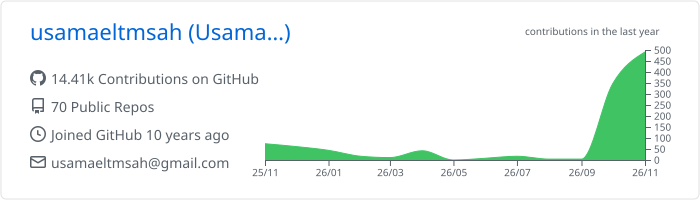
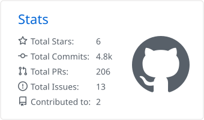
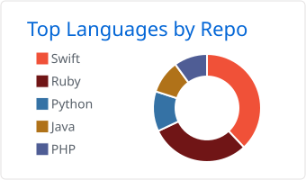
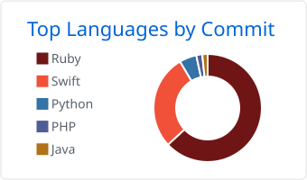
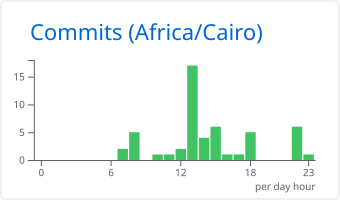
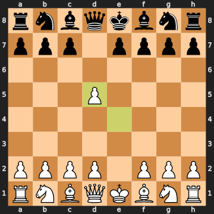

<h2 align="center">Hi there, I'm Usama Fouad </h2>

  

  
  
  

---

### 👨‍💻 About me

- 📱 Full-time **iOS Developer**, and I take on freelance work too.
- 🧱 I care about clean architecture, testable code and polished UI.
- 🌱 Currently learning: everything 🤣 (lately React Native).
- 🥅 2026 goals: take new courses, ship more projects and grow into a Senior iOS role.
- 📚 Reading: *Clean Architecture* by Robert C. Martin.
- ♟️ Fun fact: when I'm not coding, I'm playing chess.

### 🤝 Connect with me

  
  
  
  
  

  
  
  

---

### 🛠️ Languages and tools

       

---

### 📊 GitHub stats

<!-- Cards are generated by .github/workflows/profile-stats.yml, so they never depend on a third-party host being up. -->

  <picture>
    <source media="(prefers-color-scheme: dark)" srcset="./profile-summary-card-output/github_dark/0-profile-details.svg" />
    
  </picture>

  <picture>
    <source media="(prefers-color-scheme: dark)" srcset="./profile-summary-card-output/github_dark/3-stats.svg" />
    
  </picture>
  <picture>
    <source media="(prefers-color-scheme: dark)" srcset="./profile-summary-card-output/github_dark/1-repos-per-language.svg" />
    
  </picture>

  <picture>
    <source media="(prefers-color-scheme: dark)" srcset="./profile-summary-card-output/github_dark/2-most-commit-language.svg" />
    
  </picture>
  <picture>
    <source media="(prefers-color-scheme: dark)" srcset="./profile-summary-card-output/github_dark/4-productive-time.svg" />
    
  </picture>

  <picture>
    <source media="(prefers-color-scheme: dark)" srcset="https://streak-stats.demolab.com?user=usamaeltmsah&theme=github-dark-blue&hide_border=true" />
    
  </picture>

  
🏆 GitHub trophies

   
  

<picture>
  <source media="(prefers-color-scheme: dark)" srcset="https://raw.githubusercontent.com/usamaeltmsah/usamaeltmsah/output/github-snake-dark.svg" />
  
</picture>

---

### 🎮 Play with me

<!--CHESS:START-->

**♟️ Community chess:** every visitor plays the same game.

Game 1 · move 2 · **Black** to move · last: **exd5** by [@usamaeltmsah](https://github.com/usamaeltmsah)

🏆 [@usamaeltmsah](https://github.com/usamaeltmsah) (2) · [@usamaeltmsahvodafone](https://github.com/usamaeltmsahvodafone) (1)

  
Or pick a move from the list

| Piece | Moves (click to play) |
| :---: | :--- |
| ♟ **A7** | [A5](https://github.com/usamaeltmsah/usamaeltmsah/issues/new?title=chess%7Cmove%7Ca7a5%7C1&body=Just%20press%20%2A%2ACreate%2A%2A%20%E2%80%94%20no%20need%20to%20write%20anything.%20Your%20move%20is%20applied%20within%20about%20a%20minute.), [A6](https://github.com/usamaeltmsah/usamaeltmsah/issues/new?title=chess%7Cmove%7Ca7a6%7C1&body=Just%20press%20%2A%2ACreate%2A%2A%20%E2%80%94%20no%20need%20to%20write%20anything.%20Your%20move%20is%20applied%20within%20about%20a%20minute.) |
| ♟ **B7** | [B5](https://github.com/usamaeltmsah/usamaeltmsah/issues/new?title=chess%7Cmove%7Cb7b5%7C1&body=Just%20press%20%2A%2ACreate%2A%2A%20%E2%80%94%20no%20need%20to%20write%20anything.%20Your%20move%20is%20applied%20within%20about%20a%20minute.), [B6](https://github.com/usamaeltmsah/usamaeltmsah/issues/new?title=chess%7Cmove%7Cb7b6%7C1&body=Just%20press%20%2A%2ACreate%2A%2A%20%E2%80%94%20no%20need%20to%20write%20anything.%20Your%20move%20is%20applied%20within%20about%20a%20minute.) |
| ♞ **B8** | [A6](https://github.com/usamaeltmsah/usamaeltmsah/issues/new?title=chess%7Cmove%7Cb8a6%7C1&body=Just%20press%20%2A%2ACreate%2A%2A%20%E2%80%94%20no%20need%20to%20write%20anything.%20Your%20move%20is%20applied%20within%20about%20a%20minute.), [C6](https://github.com/usamaeltmsah/usamaeltmsah/issues/new?title=chess%7Cmove%7Cb8c6%7C1&body=Just%20press%20%2A%2ACreate%2A%2A%20%E2%80%94%20no%20need%20to%20write%20anything.%20Your%20move%20is%20applied%20within%20about%20a%20minute.), [D7](https://github.com/usamaeltmsah/usamaeltmsah/issues/new?title=chess%7Cmove%7Cb8d7%7C1&body=Just%20press%20%2A%2ACreate%2A%2A%20%E2%80%94%20no%20need%20to%20write%20anything.%20Your%20move%20is%20applied%20within%20about%20a%20minute.) |
| ♟ **C7** | [C5](https://github.com/usamaeltmsah/usamaeltmsah/issues/new?title=chess%7Cmove%7Cc7c5%7C1&body=Just%20press%20%2A%2ACreate%2A%2A%20%E2%80%94%20no%20need%20to%20write%20anything.%20Your%20move%20is%20applied%20within%20about%20a%20minute.), [C6](https://github.com/usamaeltmsah/usamaeltmsah/issues/new?title=chess%7Cmove%7Cc7c6%7C1&body=Just%20press%20%2A%2ACreate%2A%2A%20%E2%80%94%20no%20need%20to%20write%20anything.%20Your%20move%20is%20applied%20within%20about%20a%20minute.) |
| ♝ **C8** | [D7](https://github.com/usamaeltmsah/usamaeltmsah/issues/new?title=chess%7Cmove%7Cc8d7%7C1&body=Just%20press%20%2A%2ACreate%2A%2A%20%E2%80%94%20no%20need%20to%20write%20anything.%20Your%20move%20is%20applied%20within%20about%20a%20minute.), [E6](https://github.com/usamaeltmsah/usamaeltmsah/issues/new?title=chess%7Cmove%7Cc8e6%7C1&body=Just%20press%20%2A%2ACreate%2A%2A%20%E2%80%94%20no%20need%20to%20write%20anything.%20Your%20move%20is%20applied%20within%20about%20a%20minute.), [F5](https://github.com/usamaeltmsah/usamaeltmsah/issues/new?title=chess%7Cmove%7Cc8f5%7C1&body=Just%20press%20%2A%2ACreate%2A%2A%20%E2%80%94%20no%20need%20to%20write%20anything.%20Your%20move%20is%20applied%20within%20about%20a%20minute.), [G4](https://github.com/usamaeltmsah/usamaeltmsah/issues/new?title=chess%7Cmove%7Cc8g4%7C1&body=Just%20press%20%2A%2ACreate%2A%2A%20%E2%80%94%20no%20need%20to%20write%20anything.%20Your%20move%20is%20applied%20within%20about%20a%20minute.), [H3](https://github.com/usamaeltmsah/usamaeltmsah/issues/new?title=chess%7Cmove%7Cc8h3%7C1&body=Just%20press%20%2A%2ACreate%2A%2A%20%E2%80%94%20no%20need%20to%20write%20anything.%20Your%20move%20is%20applied%20within%20about%20a%20minute.) |
| ♛ **D8** | [D5](https://github.com/usamaeltmsah/usamaeltmsah/issues/new?title=chess%7Cmove%7Cd8d5%7C1&body=Just%20press%20%2A%2ACreate%2A%2A%20%E2%80%94%20no%20need%20to%20write%20anything.%20Your%20move%20is%20applied%20within%20about%20a%20minute.), [D6](https://github.com/usamaeltmsah/usamaeltmsah/issues/new?title=chess%7Cmove%7Cd8d6%7C1&body=Just%20press%20%2A%2ACreate%2A%2A%20%E2%80%94%20no%20need%20to%20write%20anything.%20Your%20move%20is%20applied%20within%20about%20a%20minute.), [D7](https://github.com/usamaeltmsah/usamaeltmsah/issues/new?title=chess%7Cmove%7Cd8d7%7C1&body=Just%20press%20%2A%2ACreate%2A%2A%20%E2%80%94%20no%20need%20to%20write%20anything.%20Your%20move%20is%20applied%20within%20about%20a%20minute.) |
| ♟ **E7** | [E5](https://github.com/usamaeltmsah/usamaeltmsah/issues/new?title=chess%7Cmove%7Ce7e5%7C1&body=Just%20press%20%2A%2ACreate%2A%2A%20%E2%80%94%20no%20need%20to%20write%20anything.%20Your%20move%20is%20applied%20within%20about%20a%20minute.), [E6](https://github.com/usamaeltmsah/usamaeltmsah/issues/new?title=chess%7Cmove%7Ce7e6%7C1&body=Just%20press%20%2A%2ACreate%2A%2A%20%E2%80%94%20no%20need%20to%20write%20anything.%20Your%20move%20is%20applied%20within%20about%20a%20minute.) |
| ♚ **E8** | [D7](https://github.com/usamaeltmsah/usamaeltmsah/issues/new?title=chess%7Cmove%7Ce8d7%7C1&body=Just%20press%20%2A%2ACreate%2A%2A%20%E2%80%94%20no%20need%20to%20write%20anything.%20Your%20move%20is%20applied%20within%20about%20a%20minute.) |
| ♟ **F7** | [F5](https://github.com/usamaeltmsah/usamaeltmsah/issues/new?title=chess%7Cmove%7Cf7f5%7C1&body=Just%20press%20%2A%2ACreate%2A%2A%20%E2%80%94%20no%20need%20to%20write%20anything.%20Your%20move%20is%20applied%20within%20about%20a%20minute.), [F6](https://github.com/usamaeltmsah/usamaeltmsah/issues/new?title=chess%7Cmove%7Cf7f6%7C1&body=Just%20press%20%2A%2ACreate%2A%2A%20%E2%80%94%20no%20need%20to%20write%20anything.%20Your%20move%20is%20applied%20within%20about%20a%20minute.) |
| ♟ **G7** | [G5](https://github.com/usamaeltmsah/usamaeltmsah/issues/new?title=chess%7Cmove%7Cg7g5%7C1&body=Just%20press%20%2A%2ACreate%2A%2A%20%E2%80%94%20no%20need%20to%20write%20anything.%20Your%20move%20is%20applied%20within%20about%20a%20minute.), [G6](https://github.com/usamaeltmsah/usamaeltmsah/issues/new?title=chess%7Cmove%7Cg7g6%7C1&body=Just%20press%20%2A%2ACreate%2A%2A%20%E2%80%94%20no%20need%20to%20write%20anything.%20Your%20move%20is%20applied%20within%20about%20a%20minute.) |
| ♞ **G8** | [F6](https://github.com/usamaeltmsah/usamaeltmsah/issues/new?title=chess%7Cmove%7Cg8f6%7C1&body=Just%20press%20%2A%2ACreate%2A%2A%20%E2%80%94%20no%20need%20to%20write%20anything.%20Your%20move%20is%20applied%20within%20about%20a%20minute.), [H6](https://github.com/usamaeltmsah/usamaeltmsah/issues/new?title=chess%7Cmove%7Cg8h6%7C1&body=Just%20press%20%2A%2ACreate%2A%2A%20%E2%80%94%20no%20need%20to%20write%20anything.%20Your%20move%20is%20applied%20within%20about%20a%20minute.) |
| ♟ **H7** | [H5](https://github.com/usamaeltmsah/usamaeltmsah/issues/new?title=chess%7Cmove%7Ch7h5%7C1&body=Just%20press%20%2A%2ACreate%2A%2A%20%E2%80%94%20no%20need%20to%20write%20anything.%20Your%20move%20is%20applied%20within%20about%20a%20minute.), [H6](https://github.com/usamaeltmsah/usamaeltmsah/issues/new?title=chess%7Cmove%7Ch7h6%7C1&body=Just%20press%20%2A%2ACreate%2A%2A%20%E2%80%94%20no%20need%20to%20write%20anything.%20Your%20move%20is%20applied%20within%20about%20a%20minute.) |

 
<!--CHESS:END-->

<!--GUESTBOOK:START-->
**✍️ Guestbook** · 1 signature · [**Sign it**](https://github.com/usamaeltmsah/usamaeltmsah/issues/new?title=guestbook%7Csign&body=Replace%20this%20line%20with%20your%20message%20%28up%20to%20140%20characters%29%2C%20then%20press%20%2A%2ACreate%2A%2A.)

  
Read the messages

- **[@usamaeltmsah](https://github.com/usamaeltmsah)**: Welcome to my profile\! Thanks for stopping by 👋 2026-11-14

<!--GUESTBOOK:END-->

---

  
⚡ Recent GitHub activity

<!--START_SECTION:activity-->
1. ❗ Opened issue [#7](https://github.com/usamaeltmsah/usamaeltmsah/issues/7) in [usamaeltmsah/usamaeltmsah](https://github.com/usamaeltmsah/usamaeltmsah)
2. ❗ Opened issue [#6](https://github.com/usamaeltmsah/usamaeltmsah/issues/6) in [usamaeltmsah/usamaeltmsah](https://github.com/usamaeltmsah/usamaeltmsah)
3. ❗ Opened issue [#4](https://github.com/usamaeltmsah/usamaeltmsah/issues/4) in [usamaeltmsah/usamaeltmsah](https://github.com/usamaeltmsah/usamaeltmsah)
4. ❗ Opened issue [#3](https://github.com/usamaeltmsah/usamaeltmsah/issues/3) in [usamaeltmsah/usamaeltmsah](https://github.com/usamaeltmsah/usamaeltmsah)
5. ❗ Opened issue [#2](https://github.com/usamaeltmsah/usamaeltmsah/issues/2) in [usamaeltmsah/usamaeltmsah](https://github.com/usamaeltmsah/usamaeltmsah)
<!--END_SECTION:activity-->

  
📕 Latest blog posts

<!-- BLOG-POST-LIST:START -->
- [Building sepia theme for mobile browser using CSS](https://dev.to/usamaeltmsah/building-sepia-theme-for-mobile-browser-using-css-3ei4)
<!-- BLOG-POST-LIST:END -->

  
📺 Latest YouTube videos

<!-- YOUTUBE:START -->
- [Custom Spotify Alarm](https://www.youtube.com/watch?v=94iYjuddzJI)
- [Time Hero - iOS App - Demo](https://www.youtube.com/watch?v=Lk2TXxJ44co)
- [Arduino with photo-resistor &lpar;LDR sensor&rpar;](https://www.youtube.com/shorts/EKOt_JjvD5A)
- [Minesweeper-AI CS50 AI](https://www.youtube.com/watch?v=WALsiz1YkO0)
- [Tic-Tac-Toc Ai CS50 Project 0](https://www.youtube.com/watch?v=2wItjesIV6w)
<!-- YOUTUBE:END -->

